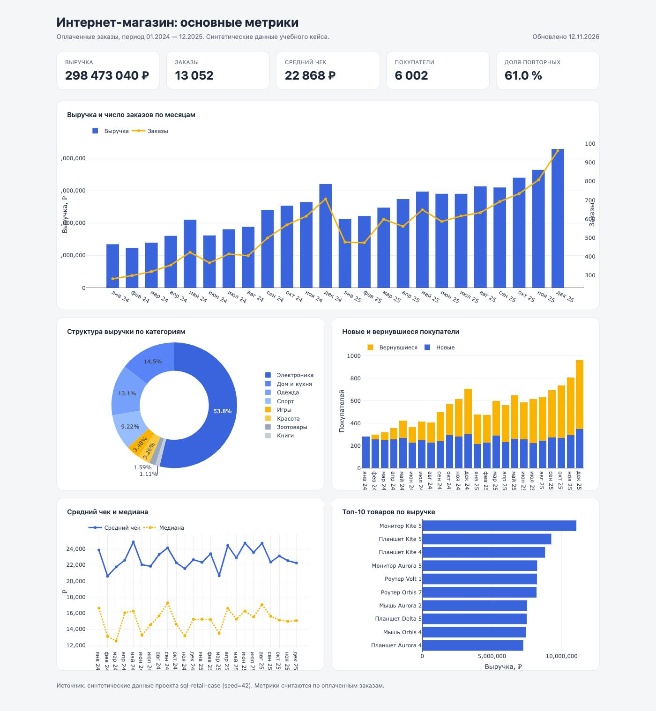

# Дашборд интернет-магазина

Статический дашборд с ключевыми метриками магазина: выручка, заказы, средний чек, покупатели и доля повторных, динамика по месяцам, структура выручки по категориям, новые и вернувшиеся клиенты, топ товаров.

Сделан как витрина к SQL-кейсу [`sql-retail-case`](../sql-retail-case): те же данные, те же определения метрик, но в виде одной HTML-страницы с интерактивными графиками Plotly.



## Что внутри

- **KPI-панель:** выручка, число оплаченных заказов, средний чек, покупатели, доля повторных.
- **Выручка и заказы по месяцам** — столбцы и линия на одной шкале.
- **Структура выручки по категориям** — кольцевая диаграмма.
- **Новые и вернувшиеся покупатели** — стек по месяцам.
- **Средний чек и медиана** — две линии, чтобы видеть влияние крупных заказов.
- **Топ-10 товаров по выручке.**

Все метрики считаются по оплаченным заказам; отменённые и возвращённые не попадают в деньги.

## Сборка

Нужны Python 3 и данные SQL-кейса.

```bash
python3 -m venv .venv
source .venv/bin/activate
pip install -r requirements.txt

python3 scripts/build_dashboard.py
```

По умолчанию скрипт читает `../sql-retail-case/data` и пишет `index.html`. Другие пути:

```bash
python3 scripts/build_dashboard.py --data ../sql-retail-case/data --out index.html
```

Если данных ещё нет, их создаёт генератор SQL-кейса:

```bash
cd ../sql-retail-case && python3 scripts/generate_data.py
```

## Открыть

```bash
python3 -m http.server 8000
# затем http://localhost:8000
```

Файл `index.html` можно открыть и напрямую, но для подгрузки Plotly с CDN нужен интернет.

## Публикация на GitHub Pages

1. Создать репозиторий и запушить содержимое папки.
2. Settings → Pages → Source: `Deploy from a branch`, ветка `main`, каталог `/ (root)`.
3. Дашборд будет доступен по адресу `https://<username>.github.io/<repo>/`.

## Ограничения

- Данные синтетические: генератор SQL-кейса создаёт их с фиксированным seed. Дашборд показывает методику и вёрстку, а не реальный рынок.
- Нет фильтров по периоду и категориям: срез фиксирован, чтобы страница оставалась одним файлом без бэкенда.
- Plotly подключается с CDN; для полностью офлайновой версии библиотеку нужно положить рядом и заменить ссылку.
- Метрики считаются в pandas на этапе сборки, а не в браузере: на больших данных это правильнее, но требует пересборки при обновлении CSV.
